<div align="center">

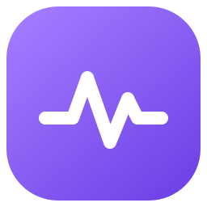

# ActivityFlow — Persian Time Tracker & Project Manager

**Offline Persian (Farsi) activity tracker, timesheet and project manager for Windows.**<br>
Log what you do, see where your time goes, and export beautiful monthly reports — with a native RTL interface and the Jalali (Shamsi) calendar.

**نرم‌افزار فارسی ثبت فعالیت، تایم‌شیت و مدیریت پروژه — آفلاین، رایگان و متن‌باز**

[](https://github.com/miladdhs/activityflow-persian-time-tracker/releases/latest)
[](https://github.com/miladdhs/activityflow-persian-time-tracker/releases)
[](https://github.com/miladdhs/activityflow-persian-time-tracker/actions/workflows/ci.yml)
[](LICENSE)
<br>
[](#-download)
[](https://www.python.org/)
[](https://doc.qt.io/qtforpython-6/)
[](https://www.sqlite.org/)

[**⬇ Download for Windows**](https://github.com/miladdhs/activityflow-persian-time-tracker/releases/latest) &nbsp;·&nbsp;
[**مستندات فارسی**](README.fa.md) &nbsp;·&nbsp;
[Features](#-features) &nbsp;·&nbsp;
[Screenshots](#-screenshots) &nbsp;·&nbsp;
[Build from source](#-run-from-source)

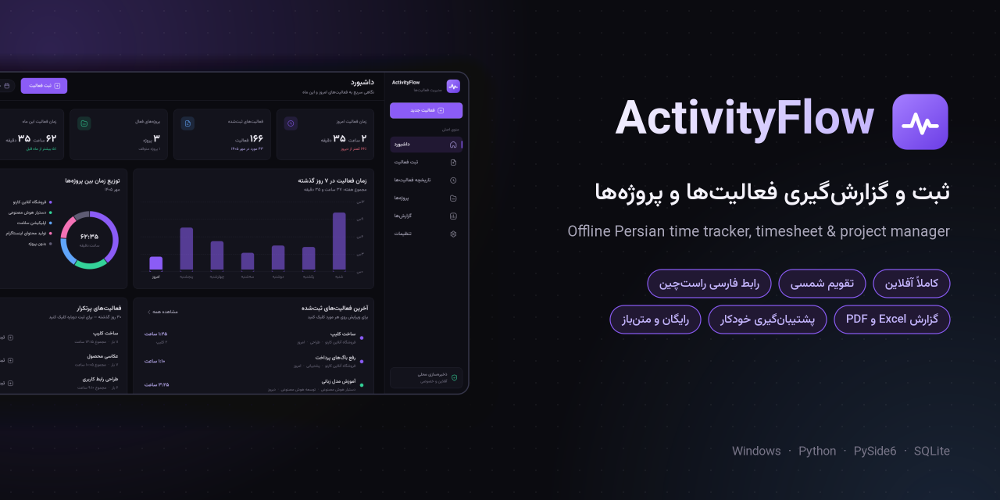

</div>

---

## 💡 Why ActivityFlow?

Freelancers, content creators, developers and small teams in Iran and Persian-speaking countries all face the same question at the end of the month: **“How many hours did I actually work, on which project, and what did I produce?”**

Most time trackers are cloud-only, English-only, subscription-based and don't understand the Jalali calendar — so people end up with messy notes and Excel sheets.

**ActivityFlow solves this with a fast, private, Persian-first desktop app:**

| The problem | How ActivityFlow solves it |
| --- | --- |
| Time trackers are online-only and need an account | **100% offline** — a single EXE, no sign-up, no internet, no telemetry |
| No proper Persian / RTL support | Native **right-to-left UI**, Vazirmatn font, Persian digits, **Jalali (Shamsi) calendar** |
| Hard to sum up the same task across projects | Same-named activities are **aggregated across all projects** in reports |
| Hours are tracked, but output (clips, pages, items…) is not | Every activity can store a **quantity with a unit** — units are never mixed |
| Month-end reporting takes hours | One-click **Excel, PDF and CSV** reports per month, year or custom range |
| Fear of losing data | **Automatic daily backups**, one-click restore and JSON export |

## ✨ Features

- **Dashboard** — today's and this month's time compared to yesterday / last month, a 7-day activity chart, time share per project, recent activities and one-click re-logging of frequent tasks.
- **Fast activity logging** — title with autocomplete and similar-title detection, project, category, Jalali date picker, duration **or** start/end time, quantity + unit, notes. Remembers your last choices; save with `Ctrl+Enter`.
- **Activity history** — full-text search, filters (project, category, unit, date range), sorting, pagination, edit / duplicate / delete, CSV export.
- **Project management** — colored project cards with status (active, paused, completed, archived), totals and last activity. Deleting a project keeps its activity history.
- **Reports & analytics** — monthly, yearly or custom periods; group by activity title, project or category; trend chart, donut chart, category breakdown and drill-down into the exact records behind every number.
- **Export** — styled **Excel (.xlsx)** workbook (RTL, multiple sheets), print-ready **PDF**, and UTF-8 **CSV** that opens correctly in Excel.
- **Data safety** — SQLite in WAL mode, daily automatic backups (last 10 kept), manual backup/restore with integrity checks, and a safety copy before every restore.
- **Customizable** — Persian or Latin digits, Jalali or Gregorian calendar, your own categories and units, merge duplicate titles.
- **Polished desktop UX** — modern dark theme, smooth page transitions, toast notifications with actions, keyboard shortcuts, single-instance protection, dark Windows title bar, HiDPI-ready.

## 📸 Screenshots

| Dashboard | Log an activity |
| :---: | :---: |
| 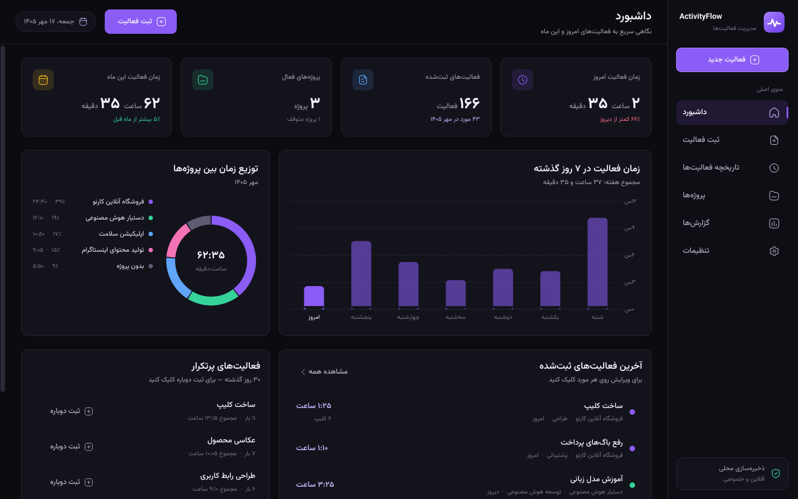 | 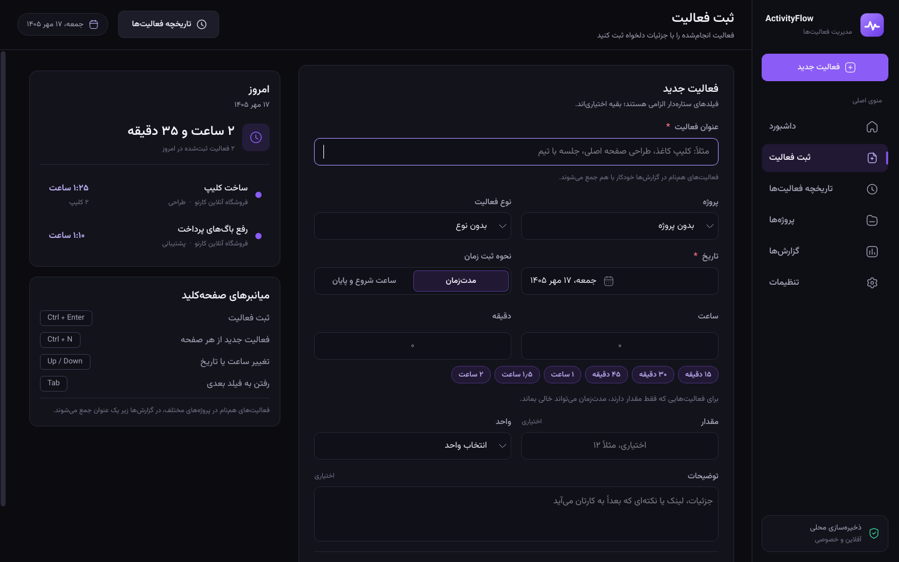 |
| **Reports (Excel / PDF export)** | **Activity history & timesheet** |
| 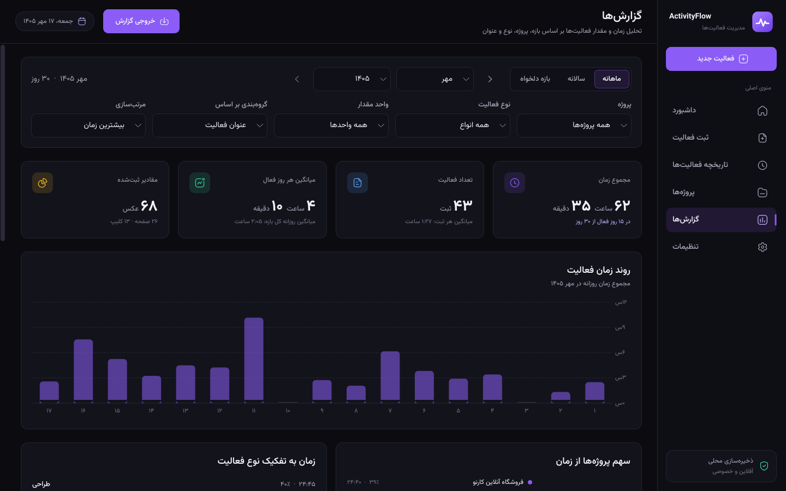 | 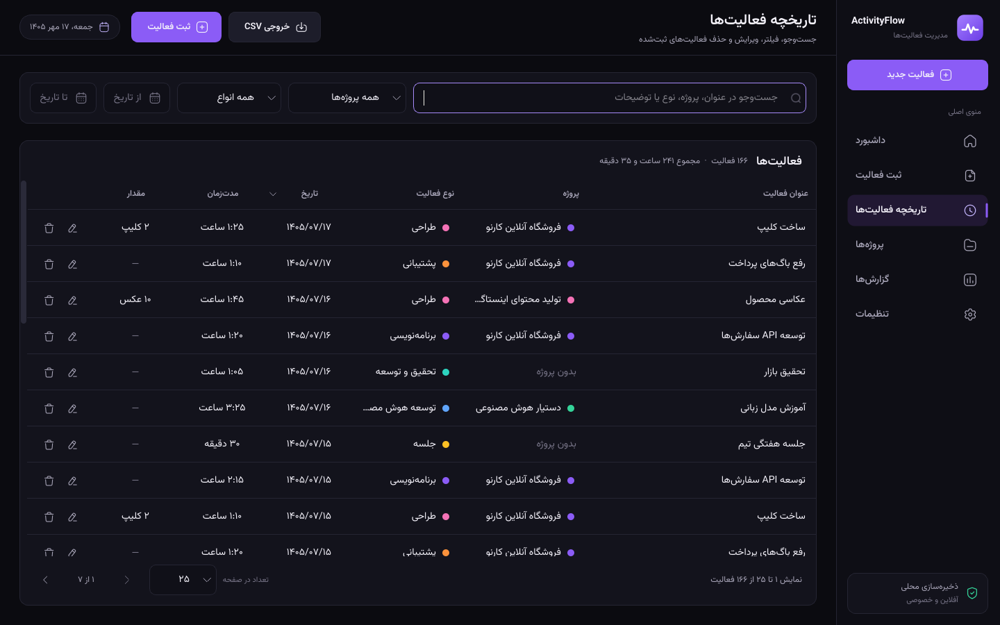 |
| **Projects** | **Settings & backups** |
| 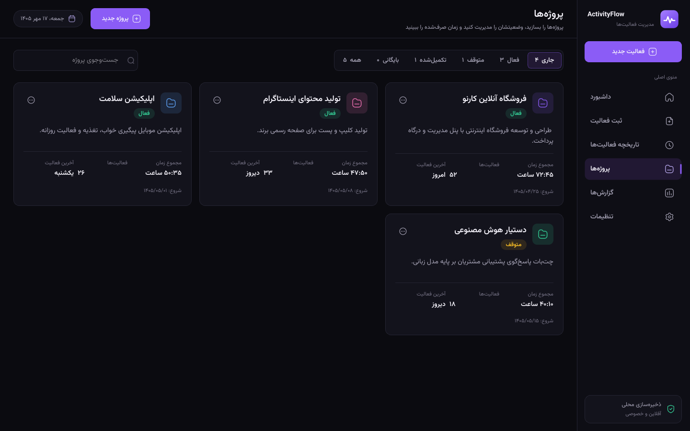 | 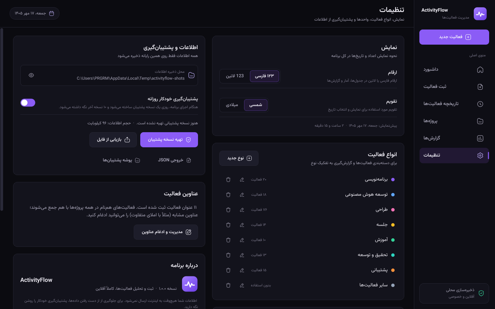 |

<details>
<summary><b>More screenshots — dialogs, Jalali date picker, drill-down</b></summary>
<br>

| Edit activity | Report drill-down |
| :---: | :---: |
| 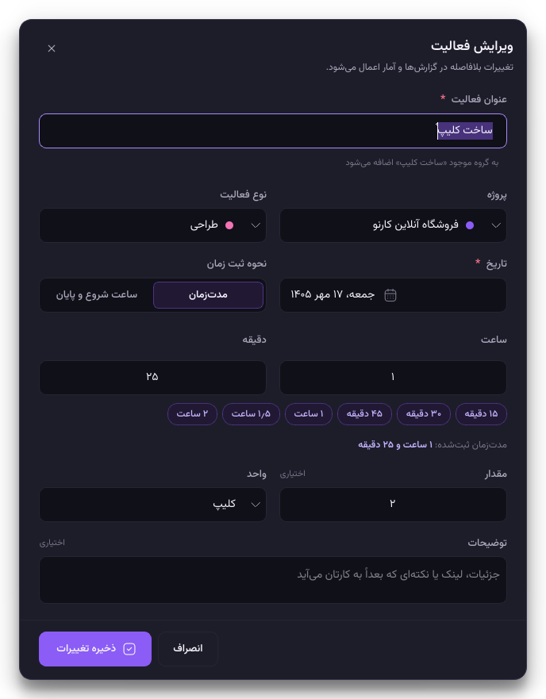 | 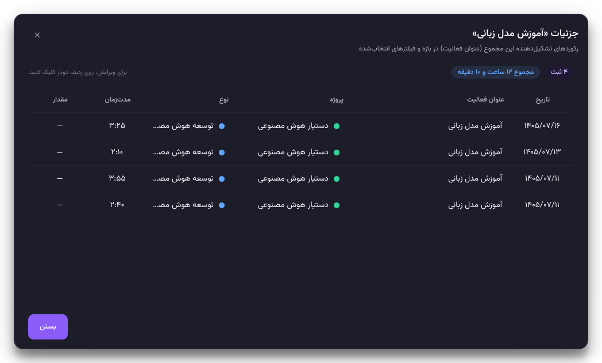 |
| **Jalali (Shamsi) date picker** | **Merge activity titles** |
| 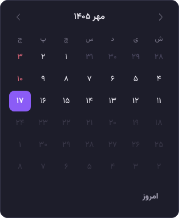 | 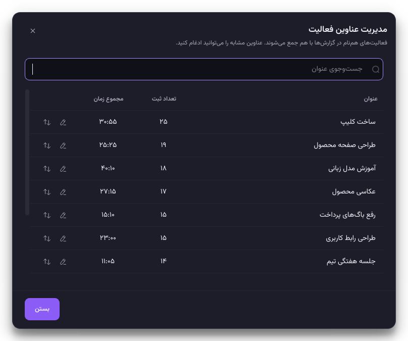 |

</details>

## ⬇ Download

1. Go to the [**latest release**](https://github.com/miladdhs/activityflow-persian-time-tracker/releases/latest).
2. Download `ActivityFlow-<version>-windows-x64.zip`, extract it and run **`ActivityFlow.exe`**.
   No installation, no Python and no internet connection required.

> [!NOTE]
> The EXE is not code-signed, so Windows SmartScreen may show *“Windows protected your PC”* the first time.
> Click **More info → Run anyway**. You can always [build it yourself](#-build-the-exe) from this source code.

## 🚀 Run from source

Requires **Python 3.11+** on Windows.

```powershell
git clone https://github.com/miladdhs/activityflow-persian-time-tracker.git
cd activityflow-persian-time-tracker
python -m venv .venv
.\.venv\Scripts\pip install -r requirements-dev.txt
.\.venv\Scripts\python main.py
```

Try it with realistic sample data (stored in a separate folder — your real data is untouched):

```powershell
.\scripts\run.ps1 -Demo
```

## 📦 Build the EXE

```powershell
.\scripts\build.ps1                 # folder build  -> dist\ActivityFlow\ActivityFlow.exe (fastest start-up)
.\scripts\build.ps1 -OneFile        # portable EXE  -> dist\ActivityFlow.exe
.\scripts\build.ps1 -OneFile -Zip   # + release zip -> dist\ActivityFlow-<version>-windows-x64.zip
```

The build script runs the test suite first, regenerates the icon and embeds version information read from
[`app/__init__.py`](app/__init__.py) — the single source of truth for the app name and version.

**Publishing a release** is automated: bump `APP_VERSION`, add a [CHANGELOG](CHANGELOG.md) entry, then push a tag —
GitHub Actions builds the EXE and attaches it to a new release.

```powershell
git tag v1.0.0
git push origin v1.0.0
```

## 🔒 Privacy, data & backups

- Everything stays on your computer in `%LOCALAPPDATA%\ActivityFlow` (database, backups and logs).
  Replacing the EXE with a newer version never touches your data.
- ActivityFlow makes **no network requests**. The only links in the app (project page, report a bug) open in your browser when you click them.
- Daily automatic backups are kept in the `backups` folder; you can also back up, restore or export everything to JSON from **Settings**.
- For testing, the data folder can be redirected with the `ACTIVITYFLOW_DATA_DIR` environment variable.

## ⌨️ Keyboard shortcuts

| Shortcut | Action |
| --- | --- |
| `Ctrl` + `N` | New activity (from any page) |
| `Ctrl` + `Enter` / `Ctrl` + `S` | Save the activity form |
| `Ctrl` + `1` … `Ctrl` + `6` | Dashboard, New activity, History, Projects, Reports, Settings |
| `Ctrl` + `F` | Search activities / projects |
| `F5` | Refresh the current page |
| `↑` / `↓` | Change time or date in the focused field |

## 🏗 Architecture

A clean, layered design: the UI never talks to the database directly, and all business rules live in plain-Python services that are fully unit-tested.

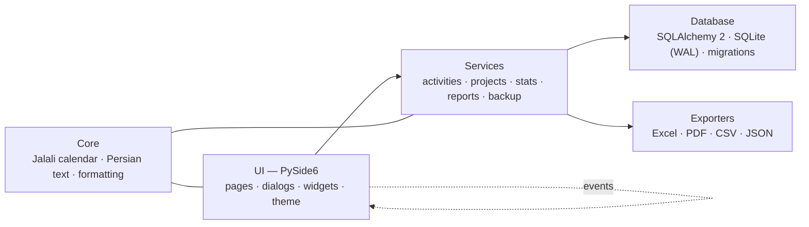

```text
app/
├── core/        Jalali calendar, Persian digit/text normalization, formatting, paths, setting keys
├── database/    engine (SQLite WAL), versioned migrations, first-run seed data
├── models/      SQLAlchemy ORM models
├── services/    business logic: activities, projects, lookups, stats, reports, backups, settings
├── reports/     Excel, PDF and CSV exporters
├── ui/          main window, pages, dialogs, reusable widgets, design tokens + QSS theme
└── resources/   Vazirmatn font, Iconly icons, logo
tests/           core, services, settings and end-to-end UI tests (offscreen Qt)
scripts/         run, build, demo data, screenshots, icon and banner generators
packaging/       PyInstaller spec (version info generated from app metadata)
docs/            screenshots, banner and the design system
```

## 🧰 Tech stack

| Layer | Technology |
| --- | --- |
| Language | Python 3.11+ |
| GUI | PySide6 (Qt 6 Widgets) with a custom design system ([docs/design-system.md](docs/design-system.md)) |
| Storage | SQLite + SQLAlchemy 2 |
| Reports | openpyxl (Excel), Qt PDF writer (PDF), CSV |
| Packaging | PyInstaller (single-file or folder build) |
| Quality | pytest (unit + offscreen UI tests), Ruff, GitHub Actions CI |

## 🧪 Tests & code quality

```powershell
$env:QT_QPA_PLATFORM = "offscreen"
.\.venv\Scripts\python -m pytest     # unit, service and end-to-end UI tests
.\.venv\Scripts\python -m ruff check .
```

Every push and pull request runs lint and the full test suite on Windows via GitHub Actions.

## 🗺 Roadmap

- [ ] Live start/stop timer for the current activity
- [ ] Light theme
- [ ] English interface (i18n)
- [ ] Windows installer and `winget` package
- [ ] CSV / Excel import
- [ ] Goals and weekly targets per project

Have an idea? [Open a feature request](https://github.com/miladdhs/activityflow-persian-time-tracker/issues/new/choose).

## ❓ FAQ

<details>
<summary><b>Is ActivityFlow free?</b></summary>

Yes. It's free and open source under the MIT license — for personal and commercial use.
</details>

<details>
<summary><b>Does it work without internet?</b></summary>

Completely. ActivityFlow is an offline desktop app; your data never leaves your computer.
</details>

<details>
<summary><b>Can I use the Gregorian calendar or Latin digits?</b></summary>

Yes — switch between Jalali/Gregorian and Persian/Latin digits in **Settings → Display**. The change applies everywhere, including reports.
</details>

<details>
<summary><b>How do I move my data to another computer?</b></summary>

Create a backup in **Settings → Backup**, copy the `.sqlite3` file to the new computer and use **Restore from file**.
</details>

<details>
<summary><b>Does it run on macOS or Linux?</b></summary>

The code is cross-platform Qt, so it runs from source; official builds currently target Windows 10/11.
</details>

## 🤝 Contributing

Contributions, bug reports and ideas are welcome! Please read [CONTRIBUTING.md](CONTRIBUTING.md) and use the
[issue templates](https://github.com/miladdhs/activityflow-persian-time-tracker/issues/new/choose).
For security issues see [SECURITY.md](SECURITY.md).

If ActivityFlow saves you time, please **⭐ star the repository** — it helps other Persian-speaking users find it.

## 🙏 Acknowledgements

- [Vazirmatn](https://github.com/rastikerdar/vazirmatn) font by Saber Rastikerdar — SIL Open Font License 1.1
- [Iconly](https://piqodesign.gumroad.com/l/iconly) icon set by Piqo Design
- [Qt for Python](https://doc.qt.io/qtforpython-6/), [SQLAlchemy](https://www.sqlalchemy.org/), [openpyxl](https://openpyxl.readthedocs.io/), [PyInstaller](https://pyinstaller.org/)

## 📄 License

[MIT](LICENSE) © 2026 Milad Dhs

<sub>Keywords: Persian time tracker, Farsi timesheet, Jalali calendar time tracking, Shamsi calendar, offline activity tracker, project time management, work hours report, freelancer timesheet, Windows desktop app, PySide6 · نرم افزار ثبت فعالیت روزانه، تایم شیت فارسی، مدیریت پروژه آفلاین، گزارش ساعت کاری ماهانه، نرم افزار مدیریت زمان، تقویم شمسی</sub>
